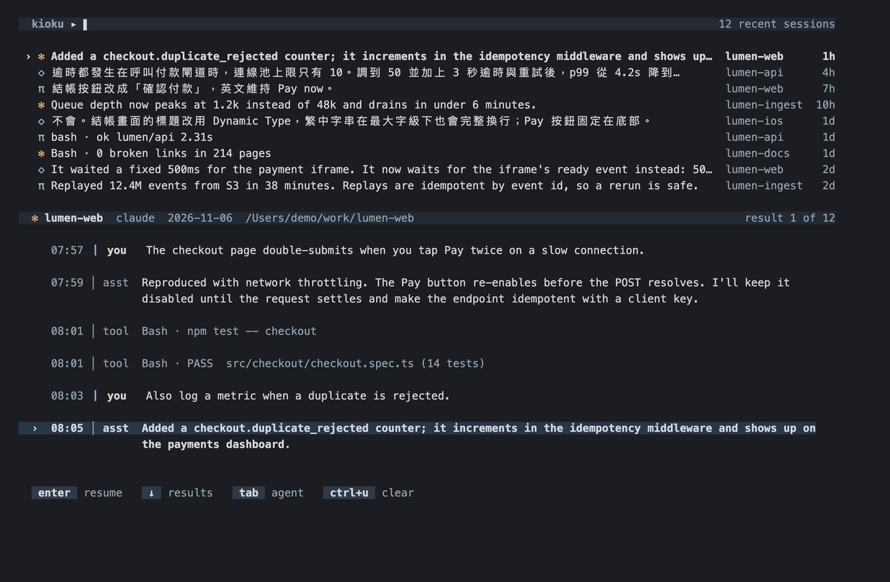
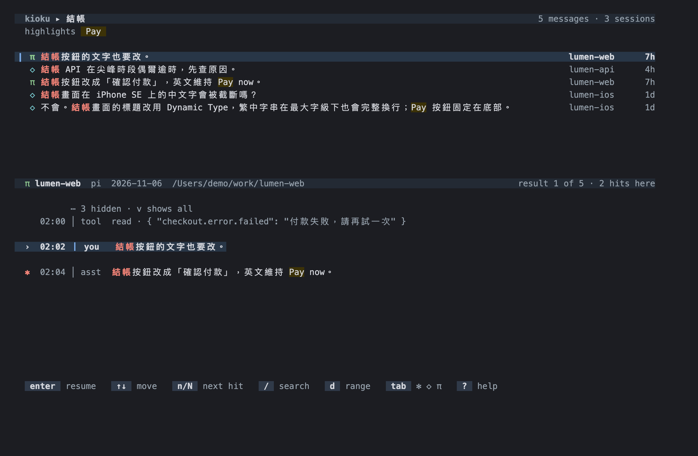

# kioku

<sub><i>kioku</i> (記憶) is Japanese for "memory".</sub>

**Search every Claude Code, Codex, Pi, Grok, OpenCode, Cursor CLI, Hermes Agent and Antigravity CLI session on macOS or Linux, down to the message, in English, Chinese, Japanese and Korean.**

<p align="center">
  
</p>

- **Message-level hits.** Every row is the message that matched, ranked by BM25, with an agent mark, project and age.
- **Real CJK search.** [fts5-cjk](https://github.com/Ray0907/fts5-cjk) is compiled in, so `結帳`, `ログイン` and `결제` match inside running text.
- **Read the context, then continue.** The transcript folds unrelated turns into `⋯`. `enter` resumes the session in its own directory with `claude --resume`, `codex resume`, `pi --session` or `opencode --session`. Grok shows only `cd <cwd>` (Enter exits and prints it); no resume flag is assumed. `o` opens the project in your editor.
- **Local and read-only.** It never edits agent transcripts or checkpoints their databases. The only application data it writes is its own index in `~/.cache/kioku`.

<p align="center">
  
</p>

<sub>The demo and screenshots show the real TUI running on a synthetic demo home (<code>demo/make_demo_home.py</code>, regenerated by <code>demo/record.sh</code> and <code>demo/screenshot.sh</code>). Every project and conversation in them is invented.</sub>

Supports macOS 12+ and Linux (arm64 and amd64).

## Install

### Homebrew (macOS, Linux)

```sh
brew install Ray0907/kioku/kioku
brew upgrade kioku
```

The [tap](https://github.com/Ray0907/homebrew-kioku) installs the prebuilt release binary. Update a Homebrew install with `brew upgrade`; `kioku update` leaves it to brew.

### Download (macOS)

Grab the archive for your Mac from [Releases](https://github.com/Ray0907/kioku/releases/latest): `darwin_arm64` for Apple Silicon, `darwin_amd64` for Intel.

```sh
arch=$(uname -m | sed 's/x86_64/amd64/')
curl -fsSLO "https://github.com/Ray0907/kioku/releases/latest/download/SHA256SUMS"
file=$(grep "darwin_${arch}" SHA256SUMS | awk '{print $2}')
curl -fsSLO "https://github.com/Ray0907/kioku/releases/latest/download/${file}"
shasum -a 256 -c SHA256SUMS --ignore-missing
tar -xzf "$file" kioku && sudo mv kioku /usr/local/bin/
```

The binary is not notarized. Downloaded with `curl` it runs as is; if you downloaded it in a browser and macOS blocks it, run `xattr -d com.apple.quarantine /usr/local/bin/kioku`.

### Download (Linux)

Grab `linux_arm64` or `linux_amd64` from [Releases](https://github.com/Ray0907/kioku/releases/latest):

```sh
arch=$(uname -m | sed 's/x86_64/amd64/;s/aarch64/arm64/')
curl -fsSLO "https://github.com/Ray0907/kioku/releases/latest/download/SHA256SUMS"
file=$(grep "linux_${arch}" SHA256SUMS | awk '{print $2}')
curl -fsSLO "https://github.com/Ray0907/kioku/releases/latest/download/${file}"
sha256sum -c SHA256SUMS --ignore-missing
tar -xzf "$file" kioku && sudo mv kioku /usr/local/bin/
```

### From source

Requires Go 1.26+ and a C compiler (Xcode Command Line Tools on macOS; GCC and libc development headers on Linux, e.g. `build-essential` on Debian/Ubuntu).

```sh
go install -tags sqlite_fts5 github.com/Ray0907/kioku@latest
# or, from a checkout:
make build
```

The `sqlite_fts5` build tag is required. `make install` puts the binary in `$(go env GOBIN)`, or `~/go/bin` when unset; make sure that directory is on your `PATH`.

If the macOS link step fails with `unknown architecture` from a `.tbd` file, your default SDK is newer than the linker. `make` already pins the macOS 26 SDK when it is installed; with `go install`, set `SDKROOT=/Library/Developer/CommandLineTools/SDKs/MacOSX26.sdk` yourself.

### Check and update

```sh
kioku --version
```

```sh
kioku update --check     # compare with the latest release, change nothing
kioku update             # download the latest release and replace this binary
```

`update` downloads the archive for your OS and CPU from the GitHub release, checks it against the release's `SHA256SUMS`, and swaps the binary in place only if everything verifies; on any failure the current binary is left as it was. The checksum file comes from the same release, so it guards against a corrupt or truncated download, not a compromised release. It needs write access to the directory holding the binary. If you installed with `go install`, `go install -tags sqlite_fts5 github.com/Ray0907/kioku@latest` works too. The index in `~/.cache/kioku` is reused; `kioku index --rebuild` rebuilds it if a release says it must.

## Use

```sh
kioku                    # recent sessions
kioku 紅茶                # interactive search
kioku --json snapshot    # compact JSON page for scripts/agents
kioku --no-redact --json snapshot # opt out of credential redaction for this CLI run
kioku --harness pi 魚池   # restrict to one agent
kioku --here snapshot    # only sessions in this project directory and its descendants
kioku --model opus snapshot # case-insensitive model substring; also --sessions and stats
kioku index              # sync and print counts
kioku doctor             # read-only source/index/SQLite checks; --json for scripts
kioku index --rebuild    # replace the index
```

When stdout is not a TTY, search prints a compact text page; `--json` prints a structured JSON page. `--version` prints the version; `--no-mouse` disables mouse input. The initial scan runs on first use; the TUI opens with its existing index and refreshes when the scan finishes.

Search: space means AND; `"black tea"` is an exact phrase; `-word` excludes; bare words are prefixes (`resum` finds `resuming`); use `kioku -- --help` to search a flag-like word. CJK terms match inside text, including single characters. Empty or negative-only queries show the latest message of each recent session. The TUI shows up to 300 results by default (the header reads `300 of N messages` when more match); one-shot text and JSON pages show 10 (`--limit N` changes either): selective queries use FTS5 BM25 (newest first on ties); queries whose positive ASCII terms and full FTS match both cover at least 90% use newest matching message time instead. Matching user/assistant messages appear before tool output, with the existing order preserved within each group. Only a single unquoted 1–2 letter Latin prefix is restricted to messages from the seven days before the index's latest timestamp; when older matches are omitted, text pages end with `N older matches omitted (--all-time)` and JSON includes `omitted_older` (a message count, including in `--sessions`). Use `--all-time` to remove this restriction.

`--here` scopes search, `--sessions` and `stats` to the nearest ancestor with a `.git` file or directory, or the working directory when none exists; home and `/` are rejected. It combines with the other filters, and cursors must keep the same scope root. Both the given root and its resolved symlink path match session directories.

Sessions started by an automated review prompt are hidden from search by default; `--include-automated` shows them. Kioku tool calls and their results are hidden from search by default; `--include-self` restores them for that run (including `--sessions`), without reindexing. User/assistant mentions remain searchable.

## For agents

kioku has a compact text and JSON CLI, an MCP server (`kioku mcp`), a Claude Code plugin and a skill. See [docs/agents.md](docs/agents.md) for flags, refs, cursors, MCP tools and setup.

`kioku mcp install [claude|codex|pi|grok ...] [--yes] [--dry-run]` registers the server with selected agents (default: all found on `PATH`).

| Key | Action |
| --- | --- |
| typing | search (30 ms debounce); Ctrl-W deletes the previous word |
| ↓ / Esc | search → results |
| ↑↓ / j k | select message; ↑ on first row returns to search |
| PgDn / PgUp | scroll the transcript a page, to read a long message to its end |
| / | focus search |
| n / N | next / previous hit in transcript |
| h / H | add a highlight / clear highlights |
| d / D | set a date range (`since..until`: `7d`, `yesterday`, `2026-10-01..2026-10-07`; same values as `--since`/`--until`) / clear it |
| p | toggle current-project scope in results; its basename replaces the date-range label while on |
| v | toggle full transcript |
| t | unfold / fold tool output (folded by default to one line with a `(+N lines)` count; a selected or matching tool message stays open) |
| r | sync the index now and re-run the search, to find sessions written since you opened kioku |
| o | open project in editor |
| y | copy resume command |
| Enter | resume selected session in its original directory |
| Tab / Shift-Tab | cycle all / claude / codex / pi / grok / opencode / cursor / hermes / agy |
| ? | help (Esc or ? closes it) |
| Ctrl-C / Esc in results | quit |

Sessions are indexed when kioku starts. To pick up ones written while it is open, press `r` (sync, then re-run the search), or set `KIOKU_SYNC_EVERY` to have kioku re-check in the background, e.g. `KIOKU_SYNC_EVERY=30s kioku`. It is off by default; the minimum is `5s`, and `0` turns it off. Background syncs never move your selection: new messages are counted in the header (`5 new · r refreshes`), and a new query or `r` includes them. They show no progress and ignore errors.

Mouse clicks select/focus rows, click a highlighter tag to remove it, and wheel scrolls. Colors follow terminal background; `KIOKU_THEME=light|dark` overrides detection.

Editor resolution: `KIOKU_EDITOR`, then `VISUAL`, then the first available `zed`, `cursor`, `code`, `subl`, then supported macOS apps/Finder or `xdg-open` on Linux (install `xdg-utils`). `$EDITOR` is not used. Terminal editors (`vim`, `nvim`, `vi`, `nano`, `hx`, `helix`, `micro`, `kak`, including absolute paths) are used only when named by `KIOKU_EDITOR` or `VISUAL`; they are not auto-detected. They suspend the TUI, run with the project directory as their working directory, and return to the TUI on exit. Only `vim`, `nvim`, `hx`, and `helix` receive `.` as a directory argument; the others start without a directory argument. Environment values can include whitespace-split arguments, passed before `.` when applicable. GUI editors still launch without waiting, with the project directory as the last argument. Clipboard uses `pbcopy` on macOS; on Linux it tries `wl-copy` in a Wayland session, then `xclip`, then `xsel`. Install `wl-clipboard` for Wayland or `xclip`/`xsel` for X11. OSC 52 is always emitted as well, supporting remote terminals that allow it.

## macOS app (round 1)

[app/Kioku.xcodeproj](app/Kioku.xcodeproj) is a two-pane, keyboard-first AppKit reader.
Build with Xcode 26 / the macOS 26 SDK; deployment target is macOS 14.
It bundles the Go CLI and uses its JSON API—no SQLite or query parser in Swift.
Search, agent/project filters, conversation previews, Resume, copy-command and
Finder-style terminal/editor Open With menus are native controls.
See [app/README.md](app/README.md) for building, E2E, limits and verification blockers.

JSON now additionally exposes `show.resume_argv` alongside the original `cwd`
and `resume_cmd`. Native clients launch structured arguments instead of parsing
shell text. Search/session snippets and show messages can include `highlights`
(`location`/`length` in UTF-16 code units, using the existing TUI display matcher);
show messages include `matches` from the Go FTS predicate so clients can fold
unrelated turns without interpreting the query.

## Data and privacy

Non-interactive message text, snippets and topics replace recognised credentials with `****` (CLI `--no-redact`, including `kioku context --no-redact`, opts out for that run; MCP cannot opt out), without changing source transcripts, the index, the TUI or `stats`.

**Local-only and read-only:** transcript stores are never changed or uploaded. The only persistent writes are the search index under `$XDG_CACHE_HOME/kioku/index.db` (or `~/.cache/kioku/index.db`). Override it with `KIOKU_INDEX`. Source roots are selected independently, in this order (first nonempty value wins):

| Harness | kioku override | Native config dir | Default |
| --- | --- | --- | --- |
| Claude Code | `KIOKU_CLAUDE_DIR` | `$CLAUDE_CONFIG_DIR/projects` | `~/.claude/projects` |
| Codex | `KIOKU_CODEX_DIR` | `$CODEX_HOME/sessions` | `~/.codex/sessions` |
| Pi | `KIOKU_PI_DIR` | `$PI_CODING_AGENT_DIR/sessions` | `~/.pi/agent/sessions` |
| Grok | `KIOKU_GROK_DIR` | — | `~/.grok/sessions` |
| OpenCode | `KIOKU_OPENCODE_DB` | `$XDG_DATA_HOME/opencode/opencode.db` | `~/.local/share/opencode/opencode.db` |
| Cursor CLI | `KIOKU_CURSOR_DIR` | — | `~/.cursor/chats` |
| Hermes Agent | `KIOKU_HERMES_DB` | `$HERMES_HOME/state.db` | `~/.hermes/state.db` |
| Antigravity CLI | `KIOKU_AGY_DIR` | — | `~/.gemini/antigravity-cli` |

Empty variables count as unset; a `~/` prefix expands to `$HOME`. kioku overrides point directly at the transcript root; native variables point at the parent config directory. A missing explicit root indexes nothing for that harness, without falling back to the default. Grok sessions are directories containing `chat_history.jsonl` and optional `summary.json`; metadata comes from the summary, with cwd/native ID falling back to the URL-decoded parent/session directory names. Only the history file is tracked for incremental appends. Use `--harness grok` to filter them. OpenCode's override points to the SQLite database, not a directory; both v1 and v2 sessions are read in read-only mode, including live WAL messages. SQLite may update transient `-shm` reader/WAL-index coordination fields; DB/WAL data is never written or checkpointed. If loading fails, cached OpenCode sessions are retained while other harnesses continue syncing. V2 takes precedence for duplicate IDs; subagent sessions and reasoning are skipped. Changed sessions are replaced using session/message timestamps rather than file appends. Use `--harness opencode` to filter them; resume runs `opencode --session <id>` from the session's directory. Set `KIOKU_DEBUG_TIMING=1` for startup/sync/query/snippet/render timings on stderr.

Cursor CLI sessions are `~/.cursor/chats/<md5(cwd)>/<session-id>/{meta.json,store.db}`. Only JSON user/assistant message blobs are read, in rowid order (an approximation: the store has no recorded message order). Binary graph nodes and Cursor IDE `state.vscdb` stores are ignored; sessions without a metadata cwd are skipped. Session start uses metadata `createdAtMs`; messages use `store.db` mtime because they have no timestamps. Changes to either file's mtime/size replace the whole session. Use `--harness cursor`; resume runs `cursor-agent --resume <id>` from the session's directory.

Hermes Agent reads only the home `state.db` (not `profiles/<name>/state.db`) in read-only mode, including live WAL data, without writing or checkpointing DB/WAL data. It indexes sessions with a nonempty cwd and no parent, skipping gateway chats, scheduled jobs, reasoning, inactive messages and compressed summaries. Older stores without cwd index nothing; missing message flags default to active and not a summary. Unix-second timestamps retain their fractions. Message count and newest message ID control whole-session replacement; unchanged sessions are not re-read, and failed loads retain cached sessions while other harnesses sync. A missing explicit path never falls back. Use `--harness hermes`; resume runs `hermes --resume <id>` from the session's directory.

Antigravity CLI uses `conversation_summaries.db` and `conversations/<id>.db` in its data directory. kioku reads these SQLite stores in read-only mode, with live WAL data. It reads user, assistant, and tool steps in step order. It skips child sessions and system steps. The metadata timestamp and step count control each index update; no file timestamp is used. Use `--harness agy` to select these sessions. Resume runs `agy --conversation <id>` from the session directory.

Search tokenization uses [fts5-cjk](https://github.com/Ray0907/fts5-cjk), linked in as a Go module (`go get github.com/Ray0907/fts5-cjk@latest` to update).

## Guides

- [Why I built kioku](https://raytien.me/writing/kioku/) ([繁體中文](https://raytien.me/writing/kioku/zh/))
- [Search Claude Code session history](https://raytien.me/kioku/claude-code/)
- [Search Codex session history](https://raytien.me/kioku/codex/)

## License

MIT. Bundles [fts5-cjk](https://github.com/Ray0907/fts5-cjk) (MIT) and SQLite headers (public domain).
